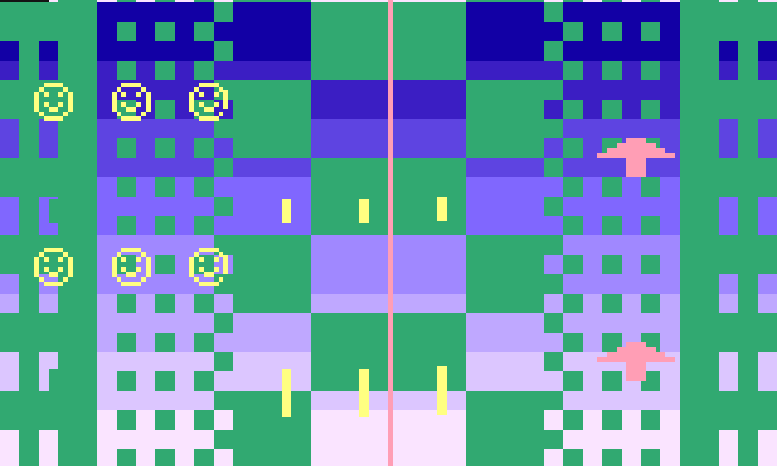

# mistang-core-atari2600

An Atari 2600 style core for MiSTang (Sipeed Tang Nano 20K). Written from scratch: cycle-exact 6502C, TIA, RIOT, one 4 KB cartridge.

- `rtl/cpu6502c.sv`: 6502 with the documented cycle timing and decimal mode. `tools/ref6502c.py` is an independent model; `tools/difftest_c.py SEED N` compares the bus trace cycle by cycle on random programs.
- `rtl/tia.sv`: playfield, two players, two missiles, ball, collision latches, WSYNC. `tools/reftia.py` rebuilds the frame from the logged register writes; `tools/difftest_sys.py rom/demo.hex 3` compares the whole frame and the latches.
- `rtl/atari_sys.sv`: CPU + TIA + RIOT + ROM, colour clock from a phase accumulator (3.579545 MHz).
- `rtl/top/atari_top.sv`: 720p60 HDMI (160x192 shown at 6x3), S1 = fire, UART screenshot stream.
- `rom/demo.s`: demo cartridge (assembled with `tools/asm6502.py`). Replace `rom/demo.hex` to run another 4 KB image.
- `build.sh`: yosys + nextpnr + gowin_pack. With seed 2 the pixel clock reaches 87 MHz (needs 74.25).

Status: verified in simulation only (3 of 3 random 6502 programs match cycle for cycle; the demo frame and collision latches match the reference). The bitstream builds and loads onto the board over JTAG, but no HDMI image has been captured yet: on 2026-11-04 the capture card showed black for every core, including the known-good Pong, so the cause is the capture chain and not this core. No board screenshot until that works.

Licence: see `LICENSE`. This core contains no Atari or MiSTer code.
